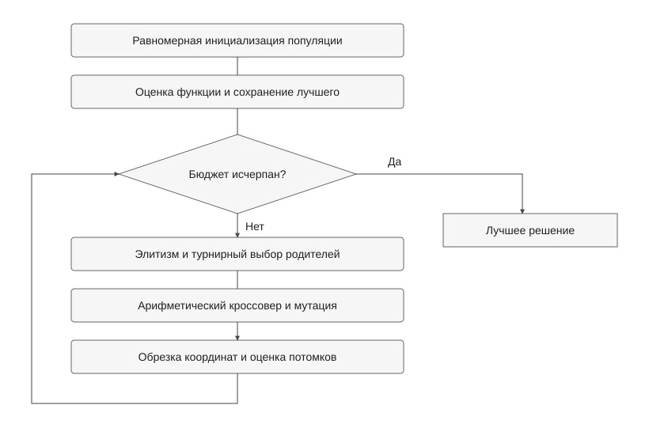

# Отчёт по лабораторной работе №1

## Многомерная оптимизация функции генетическим алгоритмом

Группа Б24-517. N = 20, Q = 1, Y = 26.
Номер варианта: V = 1 + ((17 · 20 + 7 · 1 + 26) mod 20) = 14.

## Цель работы

Реализовать генетический алгоритм для непрерывной оптимизации и исследовать
влияние масштаба мутации на качество решения. Сравнить его со случайным поиском.

## Постановка задачи

Для варианта 14 используется функция Стыблинского—Танга. Размерность
равна d = 5 + (14 mod 6) = 7. Требуется найти приближение глобального минимума:

\[
f(x)=\frac12\sum_{i=1}^7(x_i^4-16x_i^2+5x_i) \to \min,
\qquad x \in [-5,5]^7.
\]

Известный минимум достигается при xᵢ ≈ −2.903534028 для всех координат,
f(x*) ≈ −274.163159926. Он используется для оценки ошибки f(x) − f(x*).
При работе алгоритма координаты оптимума не используются.

## Представление и операторы

Особь — вектор из семи вещественных чисел. Генотип совпадает с решением задачи,
отдельное декодирование не требуется. Начальные координаты независимо выбираются
равномерно из [−5, 5].

Родители выбираются турниром из трёх разных особей: побеждает наименьшее значение
функции. Такой отбор применим и к отрицательным значениям без масштабирования.
Арифметический кроссовер для каждой координаты строит потомков:

x′ᵢ = αᵢxᵢ + (1 − αᵢ)yᵢ,
y′ᵢ = (1 − αᵢ)xᵢ + αᵢyᵢ,  αᵢ ∈ [0, 1].

Коэффициенты αᵢ выбираются независимо. Потомки остаются между родителями,
поэтому кроссовер сохраняет границы. Мутация добавляет к выбранной координате
случайную величину N(0, σ²). После мутации координата ограничивается диапазоном
[−5, 5]. Одна лучшая особь переносится без изменений, её оценка используется
повторно. Лучшее найденное решение сохраняется на протяжении всего запуска.

## Параметры и план эксперимента

| Параметр | Значение |
| --- | --- |
| Размер популяции | 100 |
| Размер турнира | 3 |
| Вероятность кроссовера пары | 0.9 |
| Вероятность мутации координаты | 1/7 |
| Сравниваемые масштабы мутации | 0.2 и 0.8 |
| Элитизм | 1 особь |
| Остановка | 50 000 вычислений функции |
| Seed | 0..19 |

Для каждой конфигурации проведено по 20 запусков. Между конфигурациями менялся
только масштаб мутации. Случайный поиск независимо генерировал точки в той же
области и сохранял лучшую при таком же бюджете.

В бюджет включены 100 оценок начальной популяции, 504 полных поколения по 99
новых оценок и четыре оценки последнего неполного поколения. Повторные оценки
элиты не выполняются. Дополнительные графики по числу вычислений позволяют
сравнивать методы при одинаковых затратах.

## Результаты

В таблице приведены итоговые лучшие значения функции по запускам.
Стандартное отклонение рассчитано по выборке; меньшие значения функции лучше.

| Метод | Лучшее | Среднее | Медиана | Стандартное отклонение | Худшее |
| --- | ---: | ---: | ---: | ---: | ---: |
| ГА, σ = 0.2 | -274.163118 | -260.026385 | -260.026397 | 15.211880 | -217.616258 |
| ГА, σ = 0.8 | -274.162648 | -264.266166 | -274.161477 | 16.600556 | -217.614085 |
| Случайный поиск | -254.508627 | -241.985756 | -240.716309 | 6.609243 | -233.343931 |

Отдельные запуски, их координаты и бюджеты приведены в [runs.csv](results/runs.csv),
сводная статистика — в [summary.csv](results/summary.csv).

Лучший результат основной серии получен при σ = 0.2, seed = 13:
f(x) = -274.163117524193, ошибка = 0.000042402.
Найденный вектор с округлением:

x = (-2.902990, -2.902804, -2.903464, -2.902594, -2.903082, -2.904195, -2.903842).

На графиках показаны минимум, среднее и максимум лучшего накопленного значения
по 20 запускам. Поколение 0 — начальная популяция; последняя точка включает
неполное поколение.

## Анализ

При σ = 0.8 среднее и медиана лучше, чем при σ = 0.2. При этом стандартное
отклонение не уменьшилось: у обеих конфигураций есть неудачные запуски.
Лучшее отдельное решение, напротив, точнее при σ = 0.2.

По каждой координате у функции есть глобальный минимум около −2.9035 и локальный
около 2.7468. Если популяция сосредоточилась у положительного минимума,
арифметический кроссовер не создаёт отрицательные значения из двух положительных.
Малые мутации хорошо уточняют решение, но затрудняют выход из этой области.
Это объясняет различие между точностью лучшего запуска и средним качеством серии.

Случайный поиск получил худшие лучшее, среднее и медианное значения. В семи
измерениях ему трудно одновременно подобрать все координаты близко к минимуму;
найденные удачные координаты не сохраняются при генерации следующей точки.

## Дополнительное сравнение: гибридная мутация

Для выхода из локальных минимумов добавлен случайный сброс координаты.
Если координата выбрана для мутации, с вероятностью 0.05 она заново выбирается
равномерно из [−5, 5], иначе применяется N(0, 0.8²). Остальные параметры сохранены.
Проведено ещё по 20 запусков базовой конфигурации σ = 0.8 и гибридного варианта
с seed 0..19 и бюджетом 50 000.

| Мутация | Лучшее | Среднее | Медиана | Стандартное отклонение | Худшее | Ошибка < 0.01 |
| --- | ---: | ---: | ---: | ---: | ---: | ---: |
| Базовая, σ = 0.8 | -274.162648 | -264.266166 | -274.161477 | 16.600556 | -217.614085 | 13/20 |
| Гибридная | -274.162785 | -274.161795 | -274.162061 | 0.000766 | -274.159989 | 20/20 |

Гибридная мутация уменьшила число застреваний: в этой серии все 20 запусков
получили ошибку менее 0.01, у базового варианта таких запусков 13.
При этом лучший отдельный результат базового варианта немного точнее.
Полные данные находятся в [improved_runs.csv](results/improved_runs.csv)
и [improved_summary.csv](results/improved_summary.csv).

## Вывод

Реализованы вещественное кодирование, турнирный отбор, арифметический кроссовер,
мутация, обработка границ и элитизм. Базовый ГА приблизил известный минимум
с ошибкой около 0.0000424 в лучшем запуске, но часть запусков завершилась
у локальных минимумов. Увеличение σ улучшило средний результат,
а добавление редкого сброса повысило устойчивость в проведённой серии.
Гибридный вариант дал приемлемое приближение с ошибкой менее 0.01 во всех
20 запусках; эта серия не гарантирует такого же результата для любого seed.
